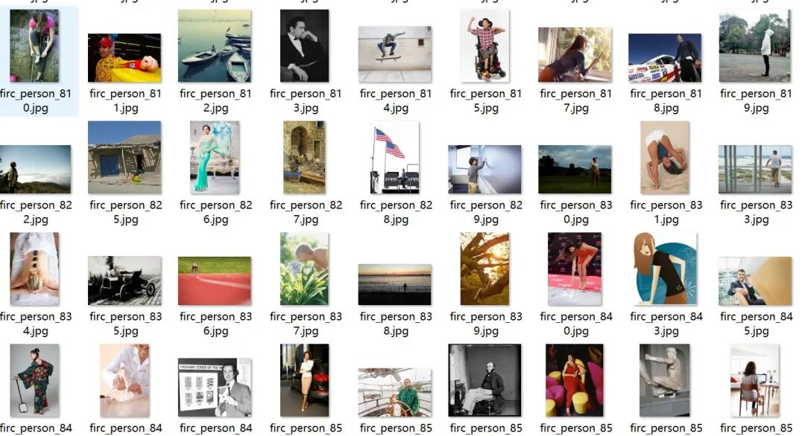
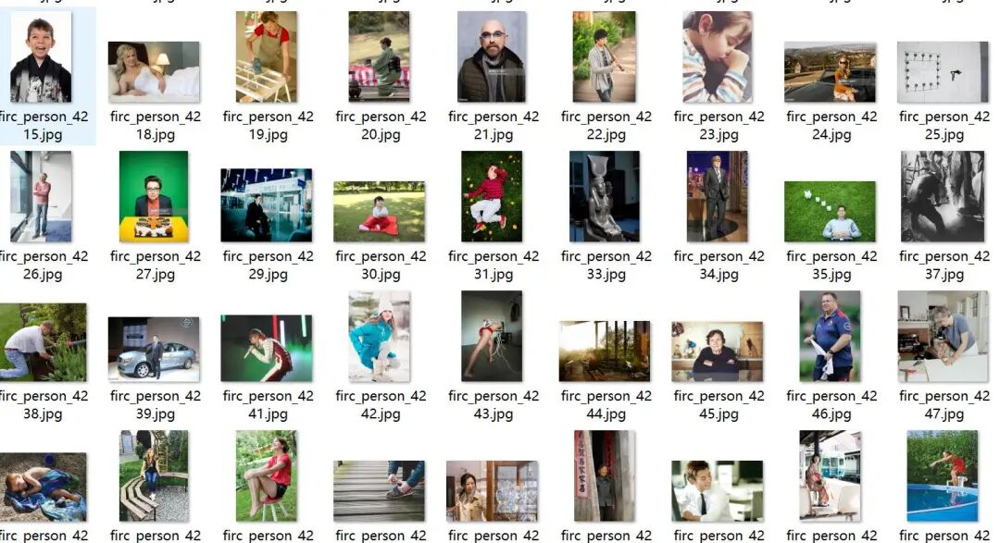
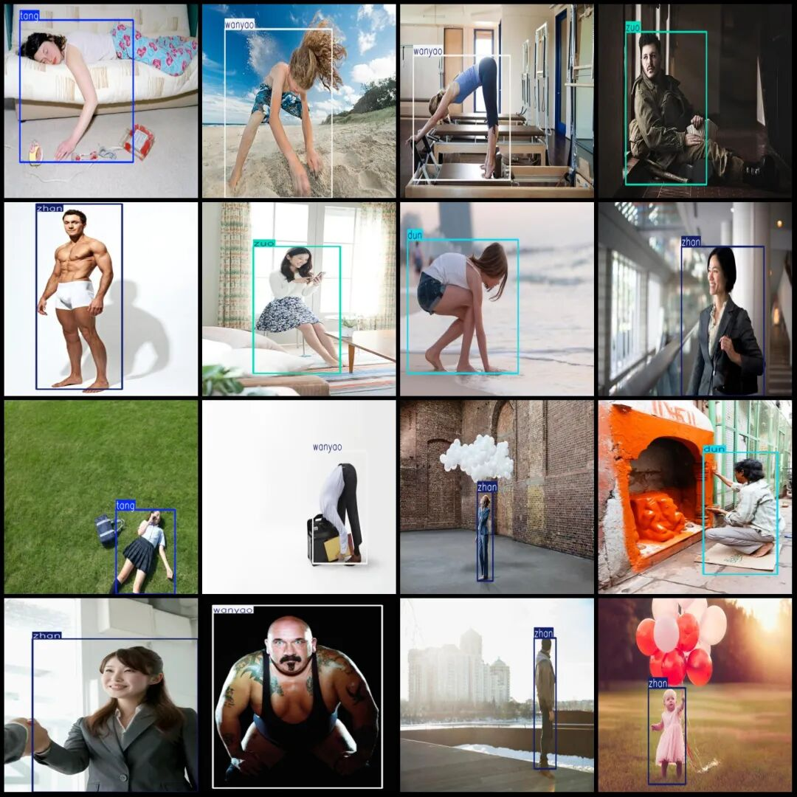

# Person Pose, Action, and Fall Detection Dataset VOC+YOLO format with 7998 images in 5 categories

Dataset format: Pascal VOC format + YOLO format (txt file without split path, only containing jpg images and corresponding VOC format xml files and yolo format txt files)

Number of images (number of jpg files): 7998

Number of annotations (number of xml files): 7998

Number of annotations (number of txt files): 7998

Label category count: 5

Label category names (Note that the order of categories in the YOLO format does not correspond to this, but is based on the labels folder's classes.txt): ["dun", "tang", "wanyao", "zhan", "zuo"]

Number of boxes labeled in each category:

Dun (squat) frame count = 1600

Tang (lying) frame count = 1601

Wanyao (bowing) frame count = 1600

Number of frames = 1600

zuo (seat) frame count = 1602

Total frame count: 8003

Number of images per category:

Dun (squatting) has 1600 images.

tang (lying) has 1599 images.

Wanyao (bowing) owns the image count = 1599

Zhan (stand) has 1600 images.

zuo (seat) occupied image count = 1601

Image resolution: Multi-resolution images, such as 343x499, 507x338, etc.

Using labelImg:

Annotation rules: Draw a rectangle around the category.

Important Notice: The dataset does not have separate training, validation, and test sets; you need to partition them yourself.

Special : This dataset does not guarantee the accuracy of the trained models or weight files.

Image Preview:

Annotation example:

## Payment

Here is a pay link on Stripe ( https://buy.stripe.com/3cs8yP7sY87d0vu9AB ). Please contact me lonlonago@foxmail.com after funding $89, and I will send you a complete data files , thank you!

